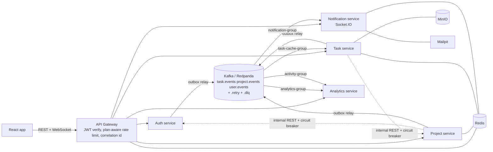

# Architecture

## Write path (command side)
1. Request reaches the gateway: JWT verified, identity headers injected, rate limit checked (one atomic Lua call).
2. The service validates, then in **one MongoDB transaction** writes the entity, its history and an **outbox** row.
3. The outbox relay publishes to Kafka (key = taskId/projectId, so one task's events stay ordered) and marks the row SENT.
   If Kafka is down, rows wait; if the relay crashes mid-publish, the row is reclaimed after 30 s. Delivery is at-least-once.

## Read path (query side)
Consumers build read models from events only: `task_snapshots`, `project_snapshots`, `activity_logs` (Analytics) and `taskdeadlines` (Notification).
Every TASK_* event carries the full task snapshot + version, so applying an event is a version-guarded upsert: replays and reordering cannot corrupt state.

## Consumer pipeline (shared/kafka)
validate envelope -> handler runs **inside the same transaction as the dedupe record** `(consumerGroup, eventId)`
-> post-commit effects (socket push, Redis counter, email) -> on failure: `.retry` topic with exponential backoff
(header `target-group` so only the failing group reprocesses) -> `.dlq` after 4 attempts -> `replay-dlq` tool.

## Multi-tenancy
`organizationId` on every document. Services only reach collections through `TenantRepository.forOrg(orgId)`; the tenant clause is AND-ed last,
`organizationId` cannot be updated, `$where` is rejected. Org comes only from the verified token (gateway headers); cache keys, Redis keys and S3 keys all embed it.

## Topics and consumer groups
| Topic | Producers | Groups |
|---|---|---|
| task.events | task-service | notification-group, analytics-group, activity-group |
| project.events | project-service | notification-group, analytics-group, activity-group, task-cache-group |
| user.events | auth-service | notification-group, analytics-group, activity-group |

Each topic has 6 partitions, plus `.retry` and `.dlq` variants.
